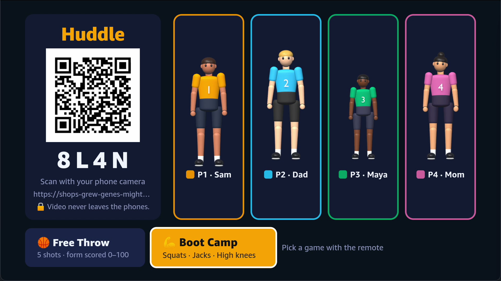
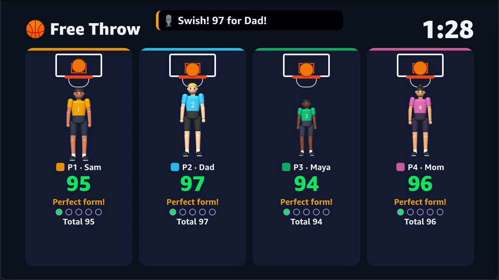
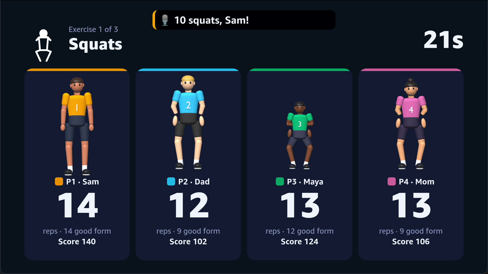
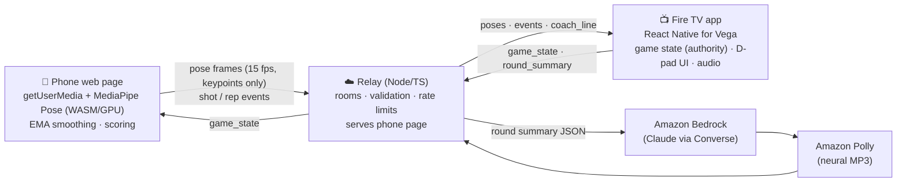
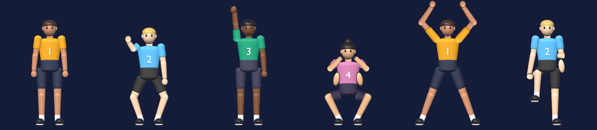

# Huddle 🏀💪

**Your phones are the Fire TV's camera.** Huddle is a living-room sports & fitness party game for **Fire TV (Vega OS)**. Up to four players prop up their phones, open a web page by scanning a QR code, and the phones run full-body pose detection on-device. Only 33 skeleton points per frame go to the TV — never video — and the TV becomes the shared arena with live form scoring and an AI coach (Amazon Bedrock + Amazon Polly).

- **Free Throw Form** — mime a free throw; each shot is scored 0–100 on elbow set angle, elbow alignment, knee bend, arm extension and follow-through, with a tip like *"Elbow in!"*.
- **Family Boot Camp** — squats → jumping jacks → high knees (40 s each). Reps are counted with hysteresis and graded good/partial; every threshold is an angle or a body-relative ratio, so a 9-year-old can fairly beat their dad.

Tracks: **Fire TV** (primary) · **AWS Builder** (Bedrock + Polly coach) · **Open Source** ([`pose-relay`](packages/pose-relay)).

| Lobby | Free Throw | Boot Camp |
|---|---|---|
|  |  |  |

**Demo video:** https://youtu.be/hY2PGKhZ_bg (2:52; regenerate locally with the steps in [Demo video](#demo-video)).
**Pitch deck:** [docs/Huddle-Pitch-Deck.pdf](docs/Huddle-Pitch-Deck.pdf)

## How it works



- **Scoring runs on the phone** at full frame rate (no network jitter); the TV owns rounds, timers and totals.
- **The TV is a WebSocket client** of the relay, so it works the same on the Vega Virtual Device and a real Fire TV.
- **The AI coach runs in the relay**, so AWS credentials never reach a client. Bedrock + Polly have a 4 s budget; on any failure the TV shows a template line as a caption. Mid-round Boot Camp callouts are pre-synthesized once at startup.
- **Privacy:** the only outbound phone messages are `join`, `pose` (numbers), `event` and `ping` — see [`apps/phone/src/main.ts`](apps/phone/src/main.ts) and the zod schemas in [`packages/protocol`](packages/protocol/src/index.ts). The relay drops anything else.

## Repository layout

```
apps/tv/             React Native for Vega app (Fire TV) — lobby, rounds, results, D-pad, Polly audio
apps/tv/avatar/      Blender script that builds the player characters and renders their cutout sprites
apps/phone/          Vite + TypeScript phone page — camera, MediaPipe, calibration, scoring, streaming
services/relay/      Node 22+ TypeScript relay — Huddle protocol on top of pose-relay, QR codes, AI coach
packages/protocol/   Message types + zod validation shared by all three
packages/scoring/    Pure TS: angles, free-throw state machine + form score, rep counters, ranking
packages/pose-relay/ Open-source library: phone camera → TV pose stream (server + phone client + example)
fixtures/            Landmark sequences for tests + the synthetic pose generator (also drives demo bots)
tools/               bots.ts (simulated players), make-fixtures.ts, mac/ helpers for the Vega Virtual Device
docs/                Phase 0 report, manual test checklist, open-source write-up
```

## Run it

### Prerequisites
- Node **22.18+** (TypeScript runs natively; tested on Node 26)
- [Vega Developer Tools](https://developer.amazon.com/docs/vega/latest/install-vega-sdk.html) (tested with SDK 0.24.12112, CLI 1.4.4) and the **Vega Virtual Device**, or a Fire TV on Vega OS
- `cloudflared` (or any HTTPS tunnel) — phones only allow camera access on HTTPS pages
- Optional: an AWS account with Bedrock model access + Polly for the live AI coach

### 1. Relay + phone page
```bash
npm install
cp .env.example .env          # fill PUBLIC_BASE_URL (+ AWS vars for the coach)
cloudflared tunnel --url http://localhost:8080   # copy the https://….trycloudflare.com URL into PUBLIC_BASE_URL
npm run dev                   # builds the phone page and starts the relay on :8080
```

### 2. TV app on the Vega Virtual Device
```bash
source ~/vega/env
vega virtual-device start
vega device start-port-forwarding -p 8080 -f false   # lets the VVD reach the relay at localhost:8080
cd apps/tv && npm install && npm run build:debug
vega run-app build/aarch64-debug/huddletv_aarch64.vpkg com.huddle.tv.main   # x86_64 build on Intel hosts
```
For a real Fire TV, set `RELAY_URL` in [`apps/tv/src/config.ts`](apps/tv/src/config.ts) to your deployed relay (`wss://…/ws`) and use the `armv7`/`aarch64` package for your device.

### 3. Play
Scan the QR on the TV with a phone → allow camera → step back until "All set" → pick a game with the remote.

**No phones handy?** `npm run bots -- <ROOM> 3` adds three simulated players, and `https://<relay>/r/<ROOM>?sim=1` opens the phone page with a simulated body instead of the camera. Both run the real scoring pipeline on synthetic motion.

Phone page flags: `?debug=1` (fps + clock offset), `?record=1` (download a landmark recording for fixtures), `?sim=1`.
TV remote: D-pad + Select to navigate, **Back** to quit a round (with confirm), **Menu** toggles the latency overlay (p50/p95 per player).

### Tests
```bash
npm test          # 50 unit tests: protocol, scoring, rep counters, avatar rig, relay rooms, pose-relay, TV game logic
npm run typecheck
```
UI and device glue are covered by the [manual test checklist](docs/manual-test-checklist.md).

## Player characters
Each player gets a stylized 3D character (own skin tone, hair, and a shirt in their player color with their number). They're modeled in **Blender** by [`apps/tv/avatar/make_avatar.py`](apps/tv/avatar/make_avatar.py) and rendered as shaded body-part sprites; a cutout rig ([`packages/scoring/src/puppet.ts`](packages/scoring/src/puppet.ts)) places, scales and rotates them from the 33 landmarks every frame — real-time on Vega with plain `Image` views, and on the phone's `?sim=1` preview with a canvas. Limb width follows body scale and length follows the bone, so foreshortened limbs shorten naturally.



Regenerate: `npm run avatar` (needs Blender 4.2+; tested with 5.2).

## AI coach (AWS Builder)

| Service | What Huddle uses it for |
|---|---|
| **Amazon Bedrock** (Converse API, model from `BEDROCK_MODEL_ID`) | After each round the TV sends a `round_summary` (scores, ranks, best/weakest component — numbers and sanitized display names only). The relay asks Claude for a ≤ 40-word, family-friendly sports-commentator line naming the winner and one concrete tip. |
| **Amazon Polly** (neural, MP3) | Voices the coach line; the TV plays it with the Vega W3C Media `AudioPlayer` and shows it as a caption. Five Boot Camp callouts ("Ten seconds left, push it!") are synthesized once at relay startup. |
| **Amazon EC2 / Lightsail** (or ECS + ALB) | Hosts the relay container; Caddy terminates TLS (see below). |

Least-privilege IAM for the relay:
```json
{ "Version": "2012-10-17", "Statement": [
  { "Effect": "Allow", "Action": "bedrock:InvokeModel", "Resource": "arn:aws:bedrock:*:*:inference-profile/<your-model-profile>" },
  { "Effect": "Allow", "Action": "bedrock:InvokeModel", "Resource": "arn:aws:bedrock:*::foundation-model/*" },
  { "Effect": "Allow", "Action": "polly:SynthesizeSpeech", "Resource": "*" } ] }
```

### Deploy the relay to AWS
AWS App Runner does not support WebSockets, so the relay runs on a small **EC2 or Lightsail instance** (or ECS behind an ALB) in the same region as your Bedrock model:
```bash
docker build -t huddle-relay .
# on the instance (Docker installed, ports 80/443 open, an instance role with the IAM policy above):
docker run -d --restart=always -p 127.0.0.1:8080:8080 \
  -e PUBLIC_BASE_URL=https://huddle.example.com -e AWS_REGION=us-east-1 \
  -e BEDROCK_MODEL_ID=us.anthropic.claude-haiku-4-5-20251001-v1:0 -e POLLY_VOICE_ID=Matthew huddle-relay
# Caddyfile:  huddle.example.com { reverse_proxy 127.0.0.1:8080 }   (automatic HTTPS + WebSockets)
```

## Demo video
Reproducible pipeline in [`demo/`](demo): `record.py` drives the Vega Virtual Device (D-pad via `inputd-cli`) and a phone page while screen-recording, `tts.py` voices [`voiceover.json`](demo/voiceover.json) (edge-tts, `en-US-GuyNeural`), and `render.py` composites [`editor.html`](demo/editor.html) frame by frame in Chrome into `demo/out/huddle-demo.mp4` + `.srt` captions.
```bash
python demo/record.py <relay-log>   # relay + tunnel + VVD running; writes demo/out/raw.mov + markers.json
python demo/tts.py && python demo/render.py   # needs: pip install edge-tts playwright
```

## Privacy & safety
- No video or images ever leave the phone; no accounts; names live in memory for the room's lifetime only.
- Every inbound message is size-capped (16 KB), rate-limited (40 msg/s per connection) and validated with zod; invalid input is dropped and logged.
- Room codes are random 4-letter codes without ambiguous characters (no I, O, 0, 1).

## Honest status
- Scoring fixtures in `fixtures/` are **synthetic** (generated by `fixtures/synth.ts`, `npm run fixtures`); record real ones with `?record=1` on a phone and drop them in. The demo video's players are the simulator bots plus a `?sim=1` phone page.
- The live Bedrock + Polly path is implemented but was not exercised in this build environment (no AWS credentials); the caption fallback was.
- Built entirely during the Amazon Developer Hackathon 2026 window. See [`FRICTION_LOG.md`](FRICTION_LOG.md) and [`FEEDBACK.md`](FEEDBACK.md).

MIT licensed — see [LICENSE](LICENSE).
